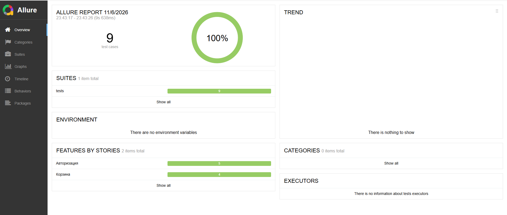

# Playwright + Allure: автотесты для SauceDemo

Учебный проект по автоматизации тестирования веб-интерфейса: UI-тесты на Python + Playwright с отчётом Allure. Тестируется демо-магазин [saucedemo.com](https://www.saucedemo.com): авторизация и корзина.

## Стек

- Python, pytest
- Playwright (pytest-playwright), браузер Chromium
- Allure Report (allure-pytest)
- Подход Page Object

Проверено на Windows 10 и Python 3.14.

## Что покрыто тестами (9 тестов)

| Область | Сценарии |
|---|---|
| Авторизация | успешный вход; ошибки при неверном пароле, заблокированном пользователе, пустом логине и пустом пароле (параметризованный тест) |
| Корзина | добавление одного и двух товаров; удаление товара; отображение товара на странице корзины |

## Структура проекта

```
├── pages/                    # Page Object: LoginPage, InventoryPage
├── tests/                    # test_login.py, test_cart.py
├── conftest.py               # фикстуры и скриншот при падении теста
├── pytest.ini                # base_url и настройки Allure
├── requirements.txt
└── allure-overview.png       # скриншот отчёта Allure
```

## Что используется в проекте

- Page Object: локаторы и действия вынесены из тестов в `pages/`.
- Параметризация: четыре негативных сценария входа в одном тесте.
- Шаги Allure (`@allure.step`), названия, severity и группировка по фичам.
- Автоматический скриншот страницы в отчёте, если тест упал.

## Как запустить

Нужны Python 3.10+, Java 8+ и Allure CLI (например, `npm install -g allure-commandline` или `scoop install allure`).

```bash
python -m venv .venv
.venv\Scripts\activate        # Windows
pip install -r requirements.txt
playwright install chromium
```

Запуск тестов:

```bash
pytest
```

Отчёт Allure:

```bash
allure serve allure-results
```

Полезные варианты запуска:

```bash
pytest --headed --slowmo 300         # смотреть выполнение в окне браузера
pytest --tracing retain-on-failure   # трейс Playwright для упавших тестов
```

## Отчёт Allure

Результат прогона: 9 тестов, все пройдены.



## Планы

- Запуск тестов в GitHub Actions и публикация отчёта на GitHub Pages
- Тесты оформления заказа (checkout)
- API-тесты
